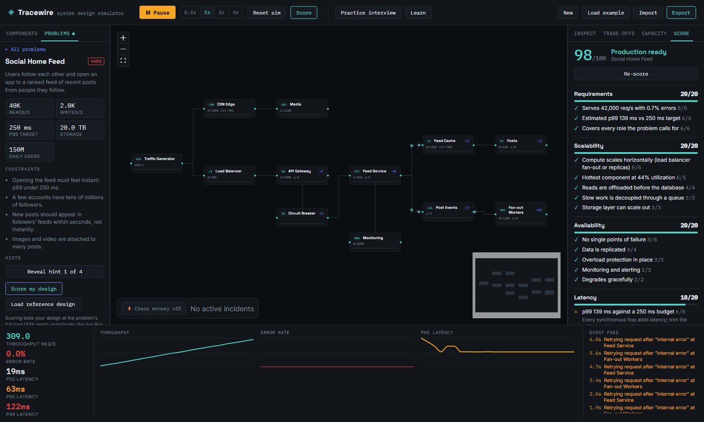
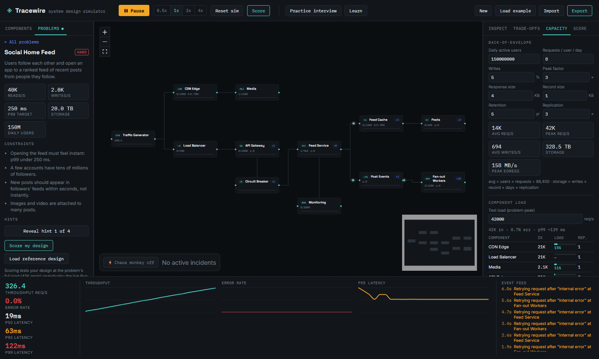
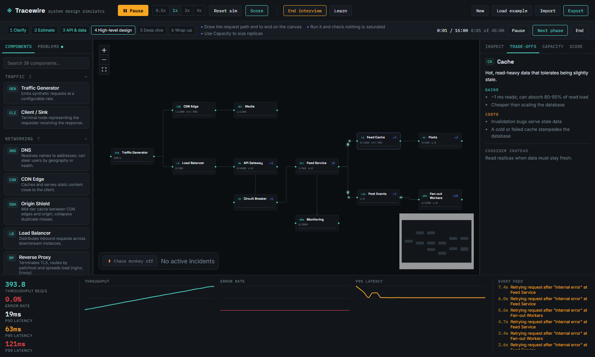

# Tracewire

**Tracewire** is a free, open-source, self-hosted system design simulator.
Drag out components — load balancers, services, databases, caches, queues,
CDNs, and more — wire them together on a canvas, and run live synthetic
traffic through the architecture. Inject real failure scenarios (kill a
node, sever a connection, spike latency, drop capacity, or let the built-in
chaos monkey do it for you) and watch retries, backpressure, and cascading
failures play out in real time on live charts.

It's built for learning and teaching system design, prototyping
architectures, and stress-testing "what happens if X goes down" scenarios
without touching real infrastructure.

It also works as an interview trainer: pick a practice problem, design
against its requirements, size it with the capacity planner, and get a
scored breakdown with concrete fixes.



---

## Table of contents

- [Features](#features)
- [Tech stack](#tech-stack)
- [Setup guide](#setup-guide)
- [How to use it](#how-to-use-it)
- [Project structure](#project-structure)
- [Contributing](#contributing)
- [Reporting bugs / getting help](#reporting-bugs--getting-help)
- [License](#license)

---

## Features

- **Visual architecture canvas** — drag-and-drop components, connect them
  with a click-and-drag, pan/zoom, minimap.
- **39 built-in components** in six searchable categories:
  - *Traffic*: Traffic Generator, Client
  - *Networking*: DNS, CDN Edge, Origin Shield, Load Balancer (round robin /
    least-connections / random), Reverse Proxy, API Gateway, Rate Limiter
  - *Compute*: Service, Auth Service, WebSocket Server, Worker Pool, Task
    Scheduler, Stream Processor, Notification Service
  - *Storage*: SQL, NoSQL, Cache, Object Storage, File Store, Search Index,
    Graph DB, Time-Series DB, Data Warehouse, Vector DB, Geospatial Index
  - *Messaging*: Message Queue, Pub/Sub Broker, Event Log
  - *Infrastructure*: Circuit Breaker, Monitoring, Service Mesh, Service
    Discovery, Coordination Service, Distributed Lock, ID Generator,
    Sharded Counter, Config Service
- **Replicas** on every scalable component, so capacity planning is a
  number you can turn, and a single replica shows up as a single point of
  failure.
- **Practice problems** — eight design problems (link shortener, social
  feed, group chat, API quotas, video streaming, ride matching,
  notifications, flash-sale checkout), each with peak requirements,
  constraints, hints revealed one at a time, and a loadable reference design.
- **Design scoring** — grades the canvas out of 100 across requirements,
  scalability, availability, latency and cost. It tests the design at the
  problem's full load (tens of thousands of req/s) with a steady-state model:
  per-component throughput from Little's law, M/M/c queueing delay,
  critical-path p99, single-point-of-failure detection and replica sizing.
  Every missed check comes with a fix.
- **Capacity planner** — back-of-envelope estimator (DAU → QPS, storage,
  egress) plus a per-component load table and one-click "right-size
  replicas".
- **Trade-offs** — gains, costs and alternatives for the selected component.
- **Practice interview mode** — six timed phases (clarify → estimate → API &
  data → high-level design → deep dive → wrap-up) with prompts per phase.
- **Sticky notes** on the canvas for assumptions and open questions.
- **Learn drawer** — concept cards (Little's law, queueing, caching,
  replication, CAP, backpressure, idempotency, SLOs) and this-vs-that
  comparisons (SQL vs NoSQL, push vs pull, and more).
- **Keyboard support** — Tab/Enter/arrows on the canvas, Delete, Esc,
  Space to run/pause, S to score, Enter on a palette item to add it.
- **Custom component builder** — define your own reusable node type by
  toggling capacity limits, latency, random failures, queueing, and
  cache-like hit-rate behavior. No coding required.
- **Realistic simulation engine**:
  - Concurrent-capacity limits per component
  - Processing latency with jitter
  - Independent failure rates *and* load-induced failures as components
    approach saturation
  - Client-side retries with backoff (and retry storms when things go
    wrong)
  - Queue backpressure and overflow handling
  - Load-balanced failover across healthy backends
  - Caches and CDNs that answer hits locally and only forward misses
  - Circuit breakers that fail fast while every downstream is down or full
- **Chaos injection** — kill/revive nodes, sever/heal connections, latency
  spikes, capacity drops, and an automatic "chaos monkey" mode that breaks
  things on its own on a timer.
- **Live metrics** — throughput, error rate, and p50/p95/p99 latency charts
  that update while the simulation runs, plus a running event log of every
  incident and recovery.
- **Save/load** — export and import diagrams as plain JSON files; your last
  diagram also auto-persists in the browser between sessions.
- **100% local, 100% free** — no account, no server, no paywall. Everything
  runs client-side in your browser.

---

## Tech stack

- [React](https://react.dev/) + [Vite](https://vitejs.dev/)
- [@xyflow/react](https://www.npmjs.com/package/@xyflow/react) — the diagram
  canvas
- [Zustand](https://www.npmjs.com/package/zustand) — state management
- [Recharts](https://recharts.org/) — the live metric charts

Pure client-side application — no backend, no database, no external API
calls required to run it.

---

## Setup guide

### Prerequisites

You need **Node.js 18+** (Node 20 LTS recommended) and npm, which ships with
Node. Check what you have:

```bash
node -v
npm -v
```

If those commands aren't found, or your Node version is older than 18,
install the LTS release from [nodejs.org](https://nodejs.org) and re-open
your terminal.

### Install & run (development mode)

```bash
git clone https://github.com/perumallavishnu/tracewire.git
cd tracewire
npm install
npm run dev
```

Open the URL printed in your terminal (usually `http://localhost:5173/`).
The app loads with an example architecture already on the canvas. Press
`Ctrl+C` in the terminal to stop the dev server.

### Production build (optional)

```bash
npm run build     # outputs an optimized build to dist/
npm run preview   # serve that build locally to sanity-check it
```

The contents of `dist/` are fully static and can be deployed to any static
host (GitHub Pages, Netlify, Vercel, S3, nginx, etc.) — there's no backend
to stand up.

### Troubleshooting

| Problem | Fix |
|---|---|
| `npm`/`node` not found | Install Node.js from nodejs.org and restart your terminal |
| Port `5173` already in use | `npm run dev -- --port 5180` |
| Blank page in the browser | Open devtools (F12) → Console tab for the real error. Confirm `npm install` finished without errors first |
| `npm install` permission errors (macOS/Linux) | Don't use `sudo npm install` — use a Node version manager like [nvm](https://github.com/nvm-sh/nvm) instead |
| Diagram doesn't persist between sessions | You may be in a private/incognito window, or have cleared site data. Use Export to save a `.json` copy |

---

## How to use it

1. **Drag components onto the canvas** from the left palette (or focus one
   and press Enter). Use the search box to find one of the 39 types.
2. **Connect components** by dragging from the small dot on the right edge
   of one component to the dot on the left edge of another.
3. **Click a component** to open the Inspector (right panel). Edit its
   capacity, latency, failure rate, queue size, cache hit rate, or
   load-balancing algorithm — sliders update live, even while the
   simulation is running.
4. **Click a connection line** to edit its network latency, or sever it to
   simulate a network partition.
5. **Press "▶ Run"** in the toolbar to start the simulation. Teal pulses
   traveling along the connections are live simulated requests; amber
   pulses are requests being retried.
6. **Speed controls** (0.5x–4x) speed up or slow down simulated time.
7. **Break things on purpose**: select a component or connection to reveal
   chaos actions in the Inspector (kill node, latency spike, drop capacity,
   sever connection), or flip on **Chaos monkey** (bottom-left over the
   canvas) to have the simulator randomly cause incidents on its own — the
   fastest way to see cascading failures and retry storms happen live.
8. **Watch the bottom dock** for live throughput / error-rate / latency
   charts and a scrolling event log of every incident.
9. **Build a custom component** via "+ New custom component" in the
   palette — toggle which behaviors it has, and it becomes reusable like any
   built-in component.
10. **Export / Import** your diagram as JSON from the toolbar to save or
    share architectures. Your most recent diagram also auto-saves to your
    browser's local storage.

### Practicing a design problem

1. Open the **Problems** tab on the left and pick a problem. Read its
   requirements and constraints; reveal hints only if you are stuck.
2. Build your design, then open **Capacity** on the right. The estimator is
   prefilled from the problem, and the load table shows each component at
   the problem's peak. Press **Right-size replicas** or tune them by hand.
3. Press **Score** (or the S key). Each category lists what earned points
   and what to change.
4. Compare with **Load reference design** (it replaces the canvas, so
   export your own first).
5. For a full mock interview, press **Practice interview** in the toolbar
   and work through the timed phases.





---

## Project structure

```
tracewire/
├── index.html                Entry HTML
├── package.json               Dependencies & npm scripts
├── docs/screenshots/          README screenshots
├── src/
│   ├── main.jsx                 React entry point
│   ├── App.jsx                  App shell & simulation loop
│   ├── styles/app.css           All styling (design tokens, layout, components)
│   ├── nodeDefs/                Component definitions, field schemas, trade-off notes
│   ├── simulation/engine.js     The live simulation engine — traffic generation,
│   │                            capacity/latency/failure modeling, retries,
│   │                            cascading failure, chaos injection
│   ├── simulation/analyze.js    Steady-state model: load, utilization, queueing,
│   │                            p99, single points of failure, replica sizing
│   ├── scoring/score.js         100-point design rubric built on analyze.js
│   ├── problems/                Practice problems and their reference designs
│   ├── interview/phases.js      Mock-interview phases and prompts
│   ├── learn/concepts.js        Learn drawer content
│   ├── store/                   Zustand stores (diagram graph, sim runtime, UI)
│   ├── utils/                   Connection geometry, number formatting
│   └── components/              UI: Canvas, Palette, Problems, RightPanel
│                                 (Inspect / Trade-offs / Capacity / Score),
│                                 Interview bar, Learn drawer, Toolbar,
│                                 Metrics dock, Chaos dock, Node builder modal
```

---

## Contributing

Contributions are welcome — bug fixes, new component types, simulation
improvements, UI polish, or documentation fixes.

1. Fork the repository and create a branch off `main`:
   `git checkout -b fix/short-description`
2. Make your changes. Try to keep pull requests focused on one thing.
3. Run the app locally (`npm run dev`) and confirm your change works and
   doesn't break existing behavior.
4. Open a pull request describing what changed and why.

See [`CONTRIBUTING.md`](CONTRIBUTING.md) for more detail, including coding
conventions and how new node types / chaos effects are structured.

Good first areas to contribute in:
- New practice problems (with a reference design that scores 90+)
- Richer component behavior (e.g. read replicas with replication lag,
  sharding with hot keys)
- Additional chaos scenarios (e.g. clock skew, DNS failure, disk full)
- Accessibility and mobile/touch support for the canvas
- Alternate persistence backends (e.g. exporting to draw.io/Mermaid)

---

## Reporting bugs / getting help

- **Bugs & feature requests**: please open a
  [GitHub Issue](https://github.com/perumallavishnu/tracewire/issues) on
  this repository, including steps to reproduce and, if relevant, your
  exported diagram JSON.
- **Questions / general discussion**: use
  [GitHub Discussions](https://github.com/perumallavishnu/tracewire/discussions)
  if enabled on the repo, or open an issue tagged `question`.

---

## License

Released under the [MIT License](LICENSE) — free to use, modify, and
distribute, including commercially.
