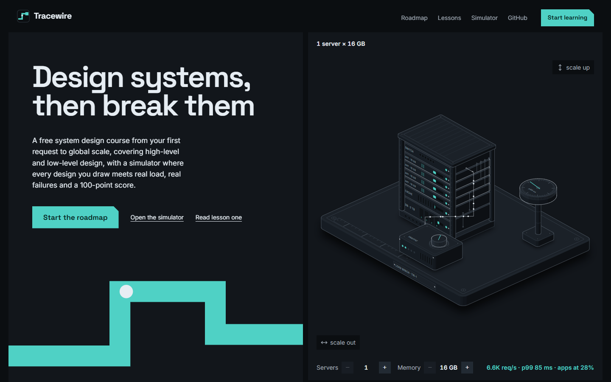
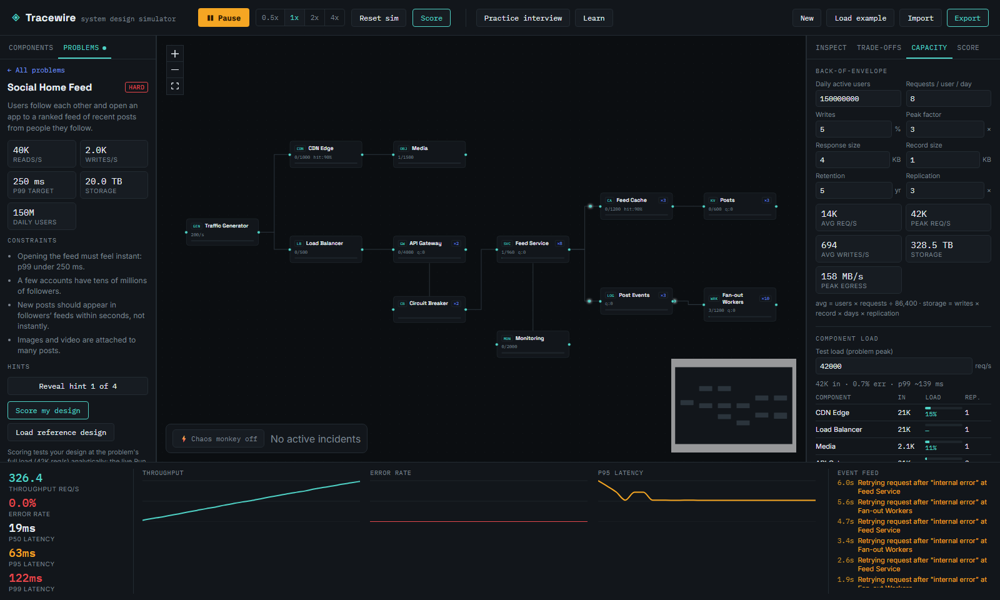
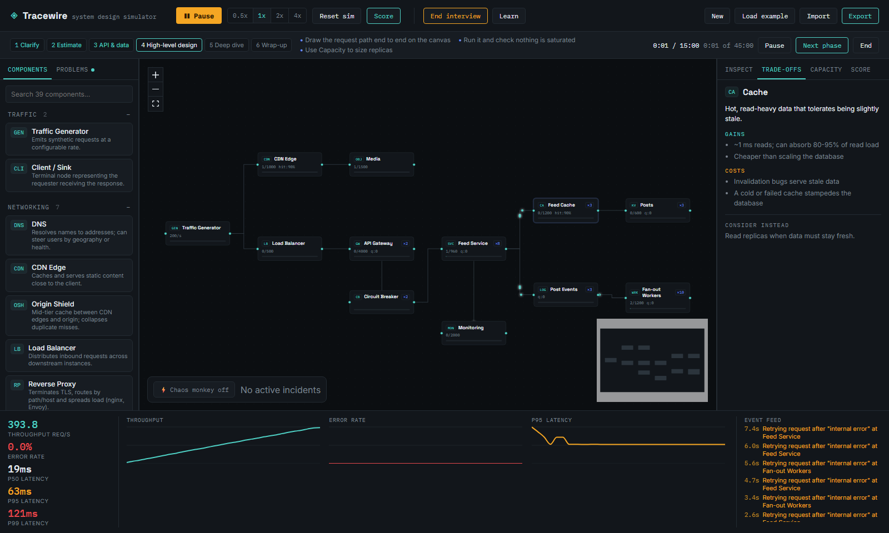

<p align="center"></p>

# Tracewire

**Learn system design by running it.** Tracewire is a free, open-source
system design course with a simulator built in. Read a lesson, draw the
architecture on a canvas, push real traffic through it, break it on
purpose, and get a 100-point score with a fix for every miss.

It covers high-level design and low-level design from beginner to advanced:
19 sections, 60 lessons, 255 concepts, a worked example with real numbers in
every section, eight practice problems with reference designs, and 45
projects to build. Everything runs in your browser. No account, no server,
no paywall.

**Version 1.0.1** · [Changelog](CHANGELOG.md) · MIT licence



---

## Table of contents

- [Features](#features)
- [Tech stack](#tech-stack)
- [Setup guide](#setup-guide)
- [Deploying to Vercel](#deploying-to-vercel)
- [How to use it](#how-to-use-it)
- [Project structure](#project-structure)
- [What is coming next](#what-is-coming-next)
- [Contributing](#contributing)
- [Reporting bugs / getting help](#reporting-bugs--getting-help)
- [License](#license)

---

## Features

### The course (`#/roadmap`, `#/learn`)
- **19 sections, 60 lessons, 255 concepts** in three zones: beginner (one
  request, end to end), intermediate (many machines, many copies) and
  advanced (correct, global, observable).
- **High-level and low-level design**: networking, APIs, databases, caching,
  estimation, sharding, consistency, queues, reliability, real-time APIs,
  specialized storage, object modelling and design patterns, consensus,
  distributed transactions, stream processing, observability, multi-region
  and security.
- **A worked example in every section**, with real numbers: why a first page
  load takes 790 ms, what an 85% cache hit rate is worth, sizing a photo
  service in five minutes, sharding chat messages, a saga for trip booking,
  setting an SLO, and a parking-lot class design with code.
- **Lesson pages** with a section tree, theory, the concepts to learn, the
  worked example, practice links into the simulator, where the topic leads
  next, and an on-this-page rail.
- **A zoomable roadmap** of the whole course: translucent level zones, linked
  sections listing every lesson and concept, and what you can build after
  each zone (real products, simulator exercises, class designs).
- **Three learning paths**: high-level design, low-level design and
  interview prep.

### The simulator (`#/sim`)
- **39 components** with icons in six searchable categories, from DNS and
  CDNs to sharded counters and distributed locks, each with replicas and
  trade-off notes.
- **Live simulation**: capacity limits, latency with jitter, random and
  load-induced failures, retries with backoff, queue backpressure, cache
  hits, circuit breakers, failover.
- **Chaos**: kill and revive nodes, sever links, spike latency, drop capacity,
  or let the chaos monkey do it.
- **Eight practice problems** with requirements, constraints, staged hints and
  reference designs.
- **Scoring** out of 100 across requirements, scalability, availability,
  latency and cost, computed at the problem's full peak load by a
  steady-state model (Little's law, M/M/c queueing, critical-path p99,
  single points of failure).
- **Capacity planner**, **practice interview mode** (six timed phases),
  sticky notes, a Learn drawer, metrics charts with real axes, and a
  **guided tour** for first-time visitors (replay it with the Guide button).
- **Save and share**: JSON export and import; your latest design is kept in
  the browser.

### The site (`#/`)
- A landing page with a draggable isometric server rack (scale out and scale
  up), a live traffic dial, an animated "broken machines to working system"
  scene, the course zone by zone, learning paths and a FAQ.
- Loading skeletons, a custom 404 page, keyboard support throughout and a
  reduced-motion mode.
- Responsive at desktop, tablet and phone sizes, including the simulator,
  which becomes a single scrolling column on small screens.

## Tech stack

- [React](https://react.dev/) + [Vite](https://vitejs.dev/)
- [@xyflow/react](https://www.npmjs.com/package/@xyflow/react) — the diagram
  canvas
- [Zustand](https://www.npmjs.com/package/zustand) — state management
- [Recharts](https://recharts.org/) — the live metric charts

Pure client-side application — no backend, no database, no external API
calls required to run it.

---

## Setup guide

### Prerequisites

You need **Node.js 18+** (Node 20 LTS recommended) and npm, which ships with
Node. Check what you have:

```bash
node -v
npm -v
```

If those commands aren't found, or your Node version is older than 18,
install the LTS release from [nodejs.org](https://nodejs.org) and re-open
your terminal.

### Install & run (development mode)

```bash
git clone https://github.com/perumallavishnu/tracewire.git
cd tracewire
npm install
npm run dev
```

Open the URL printed in your terminal (usually `http://localhost:5173/`).
The app loads with an example architecture already on the canvas. Press
`Ctrl+C` in the terminal to stop the dev server.

### Production build (optional)

```bash
npm run build     # outputs an optimized build to dist/
npm run preview   # serve that build locally to sanity-check it
```

The contents of `dist/` are fully static and can be deployed to any static
host (GitHub Pages, Netlify, Vercel, S3, nginx, etc.) — there's no backend
to stand up.

### Troubleshooting

| Problem | Fix |
|---|---|
| `npm`/`node` not found | Install Node.js from nodejs.org and restart your terminal |
| Port `5173` already in use | `npm run dev -- --port 5180` |
| Blank page in the browser | Open devtools (F12) → Console tab for the real error. Confirm `npm install` finished without errors first |
| `npm install` permission errors (macOS/Linux) | Don't use `sudo npm install` — use a Node version manager like [nvm](https://github.com/nvm-sh/nvm) instead |
| Diagram doesn't persist between sessions | You may be in a private/incognito window, or have cleared site data. Use Export to save a `.json` copy |

---

## Deploying to Vercel

The app is fully static, and `vercel.json` already configures the build.

1. Import the repository at [vercel.com/new](https://vercel.com/new). Vercel
   detects Vite; the defaults (`npm run build`, output `dist`) are correct.
2. Or from a terminal: `npx vercel login`, then `npx vercel --prod` in the
   project folder.

Routes live in the URL hash (`#/roadmap`, `#/learn/caching-101`, `#/sim`),
so any static host works the same way; unknown paths show the 404 page.

---

## How to use it

1. **Drag components onto the canvas** from the left palette (or focus one
   and press Enter). Use the search box to find one of the 39 types.
2. **Connect components** by dragging from the small dot on the right edge
   of one component to the dot on the left edge of another.
3. **Click a component** to open the Inspector (right panel). Edit its
   capacity, latency, failure rate, queue size, cache hit rate, or
   load-balancing algorithm — sliders update live, even while the
   simulation is running.
4. **Click a connection line** to edit its network latency, or sever it to
   simulate a network partition.
5. **Press "▶ Run"** in the toolbar to start the simulation. Teal pulses
   traveling along the connections are live simulated requests; amber
   pulses are requests being retried.
6. **Speed controls** (0.5x–4x) speed up or slow down simulated time.
7. **Break things on purpose**: select a component or connection to reveal
   chaos actions in the Inspector (kill node, latency spike, drop capacity,
   sever connection), or flip on **Chaos monkey** (bottom-left over the
   canvas) to have the simulator randomly cause incidents on its own — the
   fastest way to see cascading failures and retry storms happen live.
8. **Watch the bottom dock** for live throughput / error-rate / latency
   charts and a scrolling event log of every incident.
9. **Build a custom component** via "+ New custom component" in the
   palette — toggle which behaviors it has, and it becomes reusable like any
   built-in component.
10. **Export / Import** your diagram as JSON from the toolbar to save or
    share architectures. Your most recent diagram also auto-saves to your
    browser's local storage.

### Practicing a design problem

1. Open the **Problems** tab on the left and pick a problem. Read its
   requirements and constraints; reveal hints only if you are stuck.
2. Build your design, then open **Capacity** on the right. The estimator is
   prefilled from the problem, and the load table shows each component at
   the problem's peak. Press **Right-size replicas** or tune them by hand.
3. Press **Score** (or the S key). Each category lists what earned points
   and what to change.
4. Compare with **Load reference design** (it replaces the canvas, so
   export your own first).
5. For a full mock interview, press **Practice interview** in the toolbar
   and work through the timed phases.





---

## Project structure

```
tracewire/
├── index.html                Entry HTML
├── package.json               Dependencies & npm scripts
├── docs/screenshots/          README screenshots
├── src/
│   ├── main.jsx                 React entry point
│   ├── App.jsx                  App shell & simulation loop
│   ├── styles/app.css           All styling (design tokens, layout, components)
│   ├── nodeDefs/                Component definitions, field schemas, trade-off notes
│   ├── simulation/engine.js     The live simulation engine — traffic generation,
│   │                            capacity/latency/failure modeling, retries,
│   │                            cascading failure, chaos injection
│   ├── simulation/analyze.js    Steady-state model: load, utilization, queueing,
│   │                            p99, single points of failure, replica sizing
│   ├── scoring/score.js         100-point design rubric built on analyze.js
│   ├── problems/                Practice problems and their reference designs
│   ├── course/                  Course content: levels, sections, lessons, concepts, worked examples, projects
│   ├── site/                    Landing page, roadmap canvas, lesson pages
│   ├── router.js                Hash routes: #/, #/roadmap, #/learn/:section, #/sim
│   ├── interview/phases.js      Mock-interview phases and prompts
│   ├── learn/concepts.js        Learn drawer content
│   ├── store/                   Zustand stores (diagram graph, sim runtime, UI)
│   ├── utils/                   Connection geometry, number formatting
│   └── components/              UI: Canvas, Palette, Problems, RightPanel
│                                 (Inspect / Trade-offs / Capacity / Score),
│                                 Interview bar, Learn drawer, Toolbar,
│                                 Metrics dock, Chaos dock, Node builder modal
```

---

## What is coming next

Planned, not yet built:

- Progress tracking across lessons and zones
- A short quiz at the end of every lesson
- Twenty practice problems (payments, collaborative editing, metrics, search, job scheduling)
- A low-level design playground with test scenarios
- Scripted chaos drills with goals and scores
- Shareable links to a design, its score and its load test

---

## Contributing

Contributions are welcome — bug fixes, new component types, simulation
improvements, UI polish, or documentation fixes.

1. Fork the repository and create a branch off `main`:
   `git checkout -b fix/short-description`
2. Make your changes. Try to keep pull requests focused on one thing.
3. Run the app locally (`npm run dev`) and confirm your change works and
   doesn't break existing behavior.
4. Open a pull request describing what changed and why.

See [`CONTRIBUTING.md`](CONTRIBUTING.md) for more detail, including coding
conventions and how new node types / chaos effects are structured.

Good first areas to contribute in:
- New practice problems (with a reference design that scores 90+)
- Richer component behavior (e.g. read replicas with replication lag,
  sharding with hot keys)
- Additional chaos scenarios (e.g. clock skew, DNS failure, disk full)
- Accessibility and mobile/touch support for the canvas
- Alternate persistence backends (e.g. exporting to draw.io/Mermaid)

---

## Reporting bugs / getting help

- **Bugs & feature requests**: please open a
  [GitHub Issue](https://github.com/perumallavishnu/tracewire/issues) on
  this repository, including steps to reproduce and, if relevant, your
  exported diagram JSON.
- **Questions / general discussion**: use
  [GitHub Discussions](https://github.com/perumallavishnu/tracewire/discussions)
  if enabled on the repo, or open an issue tagged `question`.

---

## Credits

Isometric figures are drawn with the [anatomy](https://github.com/wheresryan22/anatomy)
kit (MIT), vendored in `src/site/iso/`. The hero rack is drawn at runtime by
`src/site/figure/rackScene.js`; `node scripts/build-rack-figure.mjs <dir>` writes
static previews for anatomy's line check. Component icons are from
[Lucide](https://lucide.dev) (ISC).

---

## License

Released under the [MIT License](LICENSE) — free to use, modify, and
distribute, including commercially.
